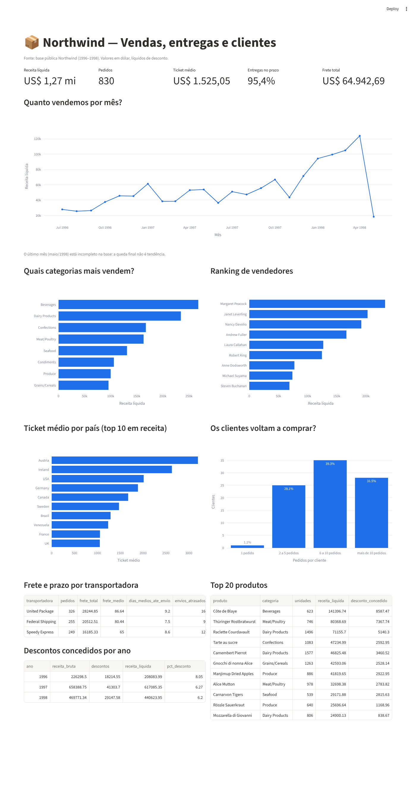

# Pipeline Northwind — do CSV ao dashboard

Projeto de engenharia de dados de ponta a ponta com **Python, SQL e DuckDB**:
ingestão de CSVs públicos, limpeza e tipagem, indicadores de negócio em SQL,
testes unitários e um dashboard em Streamlit.

Projeto final da trilha **Engenheiro de Dados Júnior — Aceleração EmpregaDados (Instituto NTA)**.



## Arquitetura

```
data/raw/*.csv ──► raw (espelho, tudo texto) ──► refined (limpo e tipado) ──► marts (KPIs) ──► dashboard
   download.py         ingestao.py                 transformacao.py            marts.py          app.py
                                                   sql/refined/*.sql           sql/marts/*.sql
```

| Camada | O que faz | Regras |
|---|---|---|
| **raw** | Cópia fiel de cada CSV | Todas as colunas como texto, nenhuma linha descartada, nomes originais |
| **refined** | Dado limpo, sem agregação | `'NULL'`/vazio → NULL, tipos corretos, snake_case, deduplicação, **validação de chave primária** (linhas = chaves distintas) |
| **marts** | Indicadores prontos para consumo | 1 arquivo SQL = 1 tabela, executados em ordem `NN_nome.sql` |

Todas as etapas são **idempotentes** (`CREATE OR REPLACE`; rodar N vezes dá o mesmo resultado)
e **tudo ou nada** (transação: se uma tabela falha, nada é gravado).

## Dados

Base pública **Northwind** (exemplo clássico da Microsoft), exportada em CSV — 8 tabelas:

| Arquivo | Tabela | Grão (chave primária) |
|---|---|---|
| orders.csv | pedidos | pedido_id |
| order_details.csv | itens_pedido | pedido_id + produto_id |
| products.csv | produtos | produto_id |
| categories.csv | categorias | categoria_id |
| customers.csv | clientes | cliente_id |
| employees.csv | vendedores | vendedor_id |
| suppliers.csv | fornecedores | fornecedor_id |
| shippers.csv | transportadoras | transportadora_id |

Os dados **não são versionados** no Git: o script `pipeline.download` baixa os arquivos da fonte.

## Indicadores (camada marts)

| # | Tabela | Pergunta de negócio |
|---|---|---|
| 01 | vendas_mensais | Quanto vendemos por mês? |
| 02 | receita_por_categoria | Quais categorias mais vendem? |
| 03 | entregas_no_prazo | Quantos pedidos foram enviados até a data prevista? |
| 04 | ticket_medio_por_pais | Qual o ticket médio por país do cliente? |
| 05 | desempenho_vendedores | Quanto cada vendedor vendeu (ranking)? |
| 06 | frete_por_transportadora | Quanto custa e quanto demora cada transportadora? |
| 07 | recompra_clientes | Os clientes voltam a comprar? |
| 08 | top_produtos | Quais produtos mais faturam? |
| 09 | descontos_por_ano | Quanto da receita bruta foi cedido em desconto? |
| 10 | kpis_resumo | Cartões do dashboard (visão geral) |

Receita = `preço × quantidade × (1 − desconto)`, calculada por item na refined.

## Como rodar

Pré-requisitos: Python 3.11+ e [uv](https://docs.astral.sh/uv/) (`pipx install uv`).

```bash
git clone <url-deste-repositorio>
cd pipeline_northwind
uv sync                                  # cria a .venv e instala as dependências

uv run python -m pipeline --baixar       # baixa os CSVs e roda raw -> refined -> marts
uv run streamlit run app.py              # abre o dashboard em http://localhost:8501
uv run python ui.py                      # (opcional) DuckDB UI para consultas SQL
```

Etapas separadas, se preferir:

```bash
uv run python -m pipeline.download
uv run python -m pipeline.ingestao
uv run python -m pipeline.transformacao
uv run python -m pipeline.marts
```

Saída esperada do pipeline completo:

```
raw.pedidos           830 linhas
raw.itens_pedido     2155 linhas
...
marts.kpis_resumo       1 linhas
10 marts gerados
```

## Testes

```bash
uv run pytest --cov
```

- Os testes usam **dados inventados** e banco temporário; nunca tocam no banco do projeto.
- Cobrem idempotência, tipagem, tratamento de `NULL`, deduplicação, validação de chave,
  rollback em caso de falha, validação dos arquivos SQL e o valor dos KPIs.
- Cobertura mínima exigida: **70%** (configurada em `pyproject.toml`; o build falha abaixo disso).

## Estrutura

```
pipeline_northwind/
├── pipeline/
│   ├── config.py          # caminhos, fonte, mapa arquivo -> tabela, chaves primárias
│   ├── db.py              # conexão DuckDB e schemas raw/refined/marts
│   ├── download.py        # baixa os CSVs públicos
│   ├── ingestao.py        # camada raw
│   ├── transformacao.py   # camada refined + validação de grão
│   ├── marts.py           # camada marts
│   └── __main__.py        # orquestrador (python -m pipeline)
├── sql/
│   ├── refined/           # 1 SELECT por tabela
│   └── marts/             # 1 SELECT por indicador (NN_nome.sql)
├── tests/                 # pytest
├── app.py                 # dashboard Streamlit
├── ui.py                  # DuckDB UI
└── pyproject.toml         # dependências (uv) e configuração de testes
```

## Boas práticas adotadas

- Ambiente isolado e reprodutível com **uv** (`pyproject.toml` + `uv.lock`); dependências de desenvolvimento separadas (`--dev`).
- Configuração centralizada, sem caminhos fixos espalhados pelo código.
- `logging` no lugar de `print`; docstrings em todas as funções.
- Dados e banco fora do Git (`.gitignore`); specs de IA mantidas localmente.
- Desenvolvido com **Spec-Driven Development**: cada etapa partiu de uma especificação
  (o que fazer, o que é proibido, reexecução, erros e critérios de aceite) e o código foi conferido contra ela.
